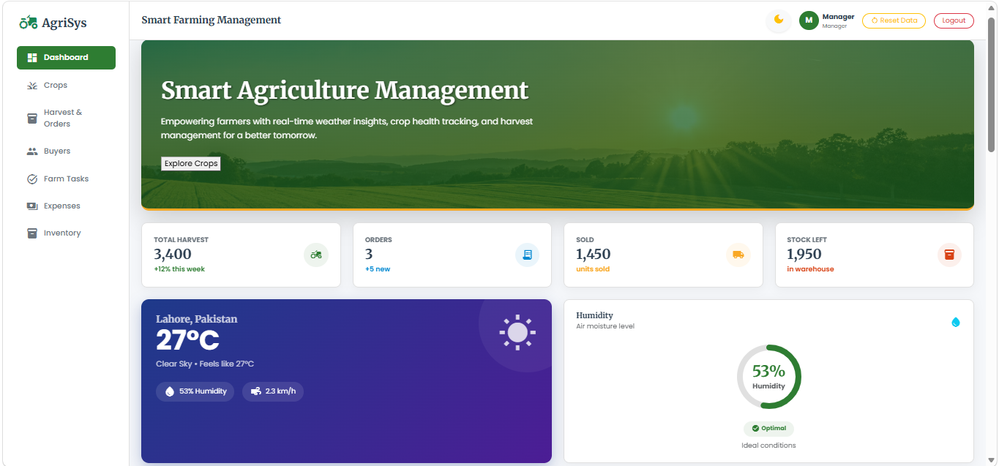
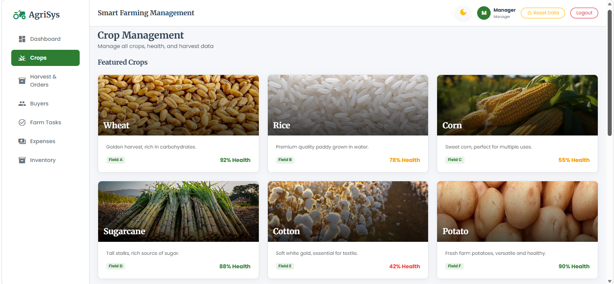
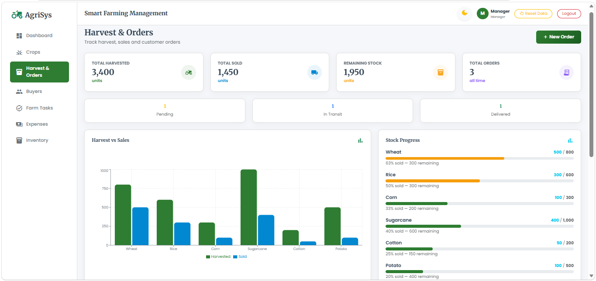
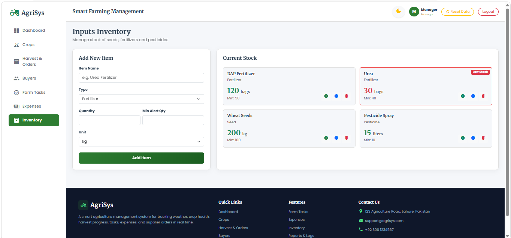

# 🌾 Agri Management System (Full Stack)

A professional, full-stack **Agriculture Management System** built with **React.js, Redux, Node.js, Express.js, and PostgreSQL**. This dashboard gives a farm manager a complete overview of field conditions, crop health, harvest progress, tasks, workforce, equipment, and profitability.

**Live Demo:** [Coming Soon...]

---

## 📸 Screenshots

### Dashboard


### Crops Management


### Harvest & Orders


### Inventory


---

## 🛠️ Tech Stack

### Frontend
| Layer | Technology |
|-------|-----------|
| UI Library | React.js (Vite) |
| State Management | Redux (Legacy Pattern with actions, reducers, thunks) |
| Styling | Bootstrap 5 & Custom CSS (3D Glassmorphism) |
| Routing | React Router DOM |
| Charts | Recharts |
| API Calls | Axios |

### Backend
| Layer | Technology |
|-------|-----------|
| Runtime | Node.js |
| Framework | Express.js |
| Database | PostgreSQL (Supabase) |
| ORM | Sequelize |
| Authentication | JWT & Bcrypt.js |
| File Uploads | Multer |

---

## 📁 Folder Structure

```text
agri-project/
├── frontEnd/       # React Frontend
│   ├── src/
│   │   ├── app/views/       # Pages (Dashboard, Crops, Workers, etc.)
│   │   ├── components/      # Reusable UI components
│   │   ├── redux/           # Actions, Reducers, Store, API
│   │   └── utils/           # Formatters, validators
│   └── package.json
│
├── backend/        # Node.js Backend
│   ├── config/              # Database connection
│   ├── controllers/         # Business logic
│   ├── middleware/          # Auth & Upload middleware
│   ├── models/              # Sequelize models (Tables)
│   ├── routes/              # API endpoints
│   ├── utils/               # Helpers (crudFactory, response)
│   ├── app.js               # Entry point
│   └── seed.js              # Demo data seeder
│
├── .gitignore
└── README.md
```

---

## 🔑 Demo Login Credentials

| Role | Username | Password |
|------|----------|----------|
| Admin | `admin` | `admin123` |
| Manager | `manager` | `manager123` |

*(Admin can add, edit, and delete records. Manager can only view and add records.)*

---

## 🚀 Setup & Installation

### Prerequisites
- Node.js (v18+)
- PostgreSQL & pgAdmin

### 1. Database Setup
1. Install PostgreSQL and pgAdmin.
2. Create a database named `agri_db`.
3. Update the `.env` file in the `backend` folder with your database credentials.

### 2. Backend Setup
```bash
cd backend
npm install
npm run seed      # Seeds demo data into the database
npm run dev       # Starts server on http://localhost:5000
```

### 3. Frontend Setup
```bash
cd frontEnd
npm install
npm run dev       # Starts React app on http://localhost:5173
```

---

## ✨ Features

### Core Modules
- 💧 **Live Weather & Humidity:** Real-time data from Open-Meteo API.
- 🌱 **Crop Health & Schedule:** Track health scores, expected yields, and cutting dates.
- 👤 **Buyer Management:** CNIC validation, photo uploads, and stock tracking.
- 📊 **Harvest & Orders:** Order creation, status tracking, and summary charts.

### Advanced Modules (v2)
- 🔐 **Authentication & Roles:** JWT-secured login for Admin and Manager.
- 👷 **Workers & Labour:** Track attendance, wages, and roles.
- 🚜 **Equipment & Maintenance:** Monitor machinery status and service intervals.
- 💰 **Expenses & Inventory:** Track farm expenses and input stock (seeds, fertilizers).
- 📈 **Reports & Activity Log:** Export financial summaries and track system activities.

---

## 👤 Author

**Ayesha Shahid**
Batch 6 — U Devs Internship

- GitHub: [@ayeshadev39](https://github.com/ayeshadev39)
- Email: 567ayesha987@gmail.com

---

⭐ If you find this project useful, please give it a star!