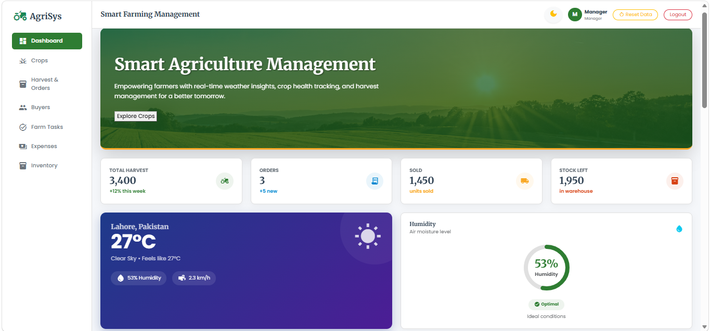
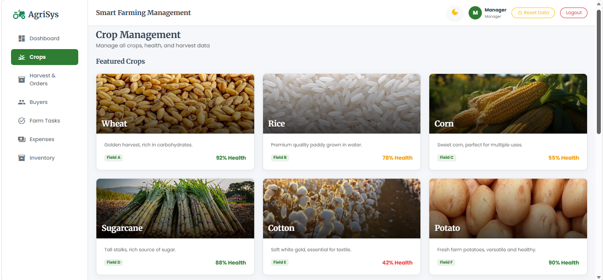
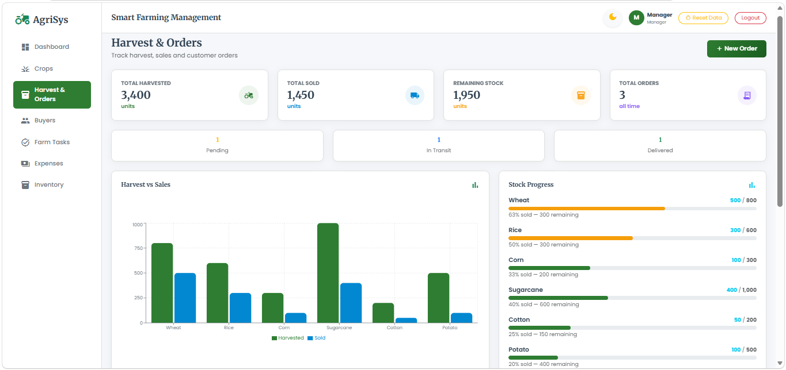
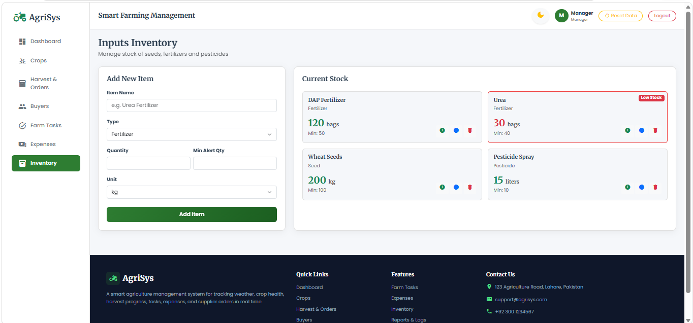

# 🌾 Agri Management System (Extended v2)

A professional, front-end **Agriculture Management System** built with **React.js**, **Redux (Legacy Pattern)**, and **Bootstrap 5**. This dashboard gives a farm manager a complete overview of field conditions, crop health, harvest progress, tasks, workforce, equipment, and profitability.

**Live Demo:** [https://agri-management-system-ayesha.netlify.app](https://agri-management-system-ayesha.netlify.app)

---

## 📸 Screenshots

### Dashboard


### Crops Management


### Harvest & Orders


### Inputs Inventory


---

## 🛠️ Tech Stack

| Layer | Technology |
|-------|-----------|
| UI Library | React.js (functional components + hooks) |
| State Management | **Redux** (Actions, API, Reducers, Store, Selectors, Middleware) |
| Persistence | Browser localStorage via Promise-based storage API |
| Styling | Bootstrap 5 + Custom CSS (3D Effects) |
| Routing | React Router DOM v7 (Protected Routes) |
| Charts | Recharts |
| Weather API | Open-Meteo (no API key required) |
| Build Tool | Vite |

---

## 📁 Folder Structure

```text
agri-management-system/
├── src/
│   ├── app/
│   │   └── views/          # Pages (Dashboard, Crops, Workers, Equipment, etc.)
│   ├── components/
│   │   ├── common/         # Navbar, Sidebar, StatCard, Modals, SearchBar, Footer
│   │   ├── dashboard/      # WeatherCard, HumidityGauge, Charts, AlertsPanel
│   │   ├── crops/          # CropForm, CropTable, CropCards
│   │   ├── harvest/        # OrderForm, OrdersTable, StockProgressBar
│   │   ├── buyers/         # BuyerForm, CnicInput, ImageUpload, BuyerTable
│   │   ├── workers/        # Worker specific components
│   │   └── equipment/      # Equipment specific components
│   ├── redux/
│   │   ├── actions/        # utilities.js, module-wise actions (REQUEST/SUCCESS/FAILURE)
│   │   ├── api/            # localStorage wrapper (storageApi), module-wise API
│   │   ├── reducers/       # module-wise reducers
│   │   ├── selectors/      # Derived data selectors (Low stock, due services, etc.)
│   │   ├── middleware/     # activityLogger (auto logs every action)
│   │   └── store/          # configureStore
│   ├── utils/              # formatters, validators, exportCsv
│   ├── data/               # seedData.js (Demo Data)
│   └── styles/             # custom.css (3D Animations & Glassmorphism)
```

---

## 🌳 Redux State Tree

```text
store
├── user        { user, role, isAuthenticated, loginLoading, loginError }
├── crops       { crops[], cropsLoading, addLoading, updateLoading, removeLoading }
├── orders      { orders[], loading }
├── buyers      { buyers[], loading }
├── weather     { data, loading, error }
├── tasks       { tasks[], loading }
├── expenses    { expenses[], loading }
├── inventory   { items[], loading }
├── workers     { workers[], loading }
├── attendance  { records[], loading }
├── equipment   { equipment[], loading }
├── maintenance { services[], loading }
└── activity    { logs[] }
```

---

## 🔄 Data Flow

Component (user clicks Save) 
⇒ `dispatch(ADD_CROP(data))` 
⇒ Thunk dispatches `REQUEST` 
⇒ `redux/api` writes to localStorage and returns a response 
⇒ Thunk dispatches `SUCCESS` (or `FAILURE`) 
⇒ Reducer builds the new state 
⇒ Store notifies subscribers 
⇒ `useSelector` re-renders the UI.

*(Middleware: `activityLogger` records who changed what and keeps localStorage in sync).*

---

## 🔑 Demo Login Credentials

| Role | Username | Password | Permissions |
|------|----------|----------|-------------|
| Admin | `admin` | `admin123` | Full Access (View, Add, Edit, Delete, Reports) |
| Manager | `manager` | `manager123` | Restricted (View, Add only) |

---

## ✨ Features

### Core Modules
- 💧 **Humidity Gauge** — Live humidity with Low / Optimal / High status.
- 🌤️ **Live Weather** — Temperature, humidity, wind speed, rain chance, and 5-day forecast.
- 🌱 **Crop Health** — List and doughnut chart with color-coded status badges.
- 📅 **Cutting Schedule** — Table of upcoming harvest dates with days remaining.
- 📊 **Harvest & Orders Summary** — KPI cards.
- 👤 **Buyer Form** — Full name, CNIC (auto-formatted), photo upload.

### Professional Features (v1)
- 🔐 **Login & Role-based Access** — Admin and Manager roles.
- ✅ **Farm Task Scheduler** — Irrigation, fertilizer, spraying tasks with due-date alerts.
- 💰 **Expense & Profit Tracker** — Expenses per crop, Revenue vs Expense chart.
- 📦 **Inputs Inventory** — Seeds, fertilizers, pesticides stock with Low Stock alerts.
- 📈 **Reports & Activity Log** — Monthly summary exportable to CSV.

### New Features (v2)
- 👷 **Workers & Labour Management** — Full CRUD for workers, daily attendance register, wage management.
- 🚜 **Equipment & Maintenance Tracker** — Full CRUD for machinery, service interval calculation, next service alerts.

---

## 🚀 Setup & Installation

### Prerequisites
- Node.js (v18 or higher)
- npm

### Steps

```bash
# 1. Clone the repository
git clone https://github.com/ayeshadev39/agri-management-system-ayesha.git

# 2. Navigate to the project folder
cd agri-management-system-ayesha

# 3. Install dependencies
npm install

# 4. Start the development server
npm run dev

# 5. Open in browser
http://localhost:5173
```

---

## 💾 Data Storage

All data is stored in the browser's **localStorage** — no backend required. Data persists across page refreshes.

---

## 👤 Author

**Ayesha Shahid**
Batch 6 — U Devs Internship

- GitHub: [@ayeshadev39](https://github.com/ayeshadev39)
- Email: 567ayesha987@gmail.com

---

## 📄 License

This project is created as part of the **U Devs Batch 6 Full Stack Internship Task**.

---

⭐ If you find this project useful, please give it a star!